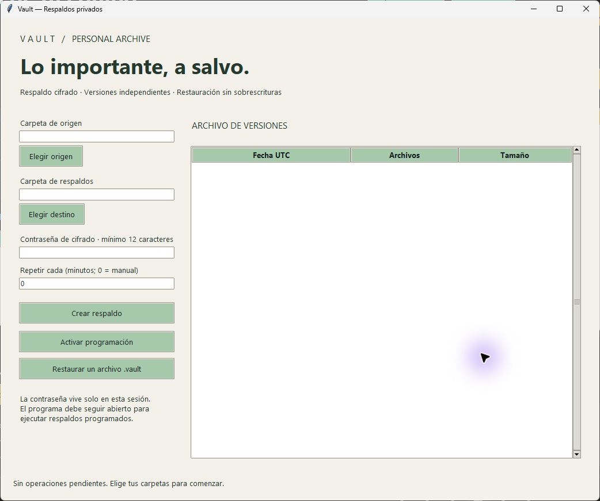

# Vault

Encrypted, versioned folder backups with safe restoration and an in-app scheduler.

[](https://github.com/MIGUEL-MOSCOSO-DEV/vault/actions/workflows/ci.yml) · [Descargas](https://github.com/MIGUEL-MOSCOSO-DEV/vault/releases/latest) · [MIT](LICENSE)

Respaldos de carpetas con cifrado, historial y restauración en una ubicación nueva. Tus archivos y tu contraseña permanecen en tu equipo.



## Qué incluye

- Cifrado autenticado AES-256-GCM por bloques y clave derivada con scrypt.
- Versiones .vault independientes, con historial local de fecha, cantidad y tamaño.
- Programación en la aplicación, desde cinco minutos, mientras permanezca abierta.
- Restauración con verificación de integridad, rutas seguras y sin sobrescribir carpetas existentes.

## Descargar para Windows

En [Releases](https://github.com/MIGUEL-MOSCOSO-DEV/vault/releases/latest) encontrarás Vault.exe y su archivo SHA256SUMS.txt. Es una aplicación portable para Windows 10/11 de 64 bits: no necesita instalar Python ni permisos de administrador. Abre el ejecutable para iniciar. Los ejecutables no tienen firma digital.

## Ejecutar desde el código

Necesitas Python 3.11 o superior con Tkinter. Crea un entorno virtual para mantener las dependencias separadas.

```sh
git clone https://github.com/MIGUEL-MOSCOSO-DEV/vault.git
cd vault
python -m venv .venv
```

En Windows:

```powershell
.venv\Scripts\python.exe -m pip install .
.venv\Scripts\python.exe launch.py
```

En Linux o macOS puedes usar .venv/bin/python. Tkinter debe estar disponible en tu instalación de Python; la revisión visual y los ejecutables publicados corresponden a Windows.

## Uso

Selecciona origen y destino en carpetas diferentes, introduce una contraseña de al menos 12 caracteres y pulsa Crear respaldo. Para recuperar archivos, usa Restaurar un archivo .vault con esa misma contraseña. Se crea una subcarpeta nueva. La programación y la contraseña no se guardan entre sesiones.

## Datos y privacidad

La instalación comienza sin registros de demostración. Los datos locales se guardan en ~/.vault (la carpeta de tu usuario). Puedes cambiar esa ubicación con la variable VAULT_HOME. El historial contiene rutas y metadatos; los respaldos cifrados se guardan en el destino que elijas. La contraseña no se persiste.

## Alcance actual

Cada versión es una copia completa, no incremental. No utiliza VSS: cierra los archivos que puedan cambiar mientras se respaldan. Se omiten enlaces simbólicos y puntos de reanálisis; no conserva permisos NTFS ni flujos alternativos. La restauración admite hasta 50 GB descomprimidos y 100000 entradas. El formato tiene pruebas de integridad, pero no ha pasado una auditoría criptográfica independiente. Conserva la contraseña fuera del programa: no existe recuperación.

## Desarrollo y pruebas

```sh
python -m pip install . -r requirements-dev.txt
python -m ruff check .
python -m ruff format --check .
python -m unittest discover -s tests -v
```

Las pruebas usan directorios y datos temporales. GitHub Actions verifica formato y pruebas en Windows y Linux y construye un ejecutable de Windows como artefacto del workflow. No hay una aplicación web ni un servidor remoto requerido.

## Generar el ejecutable

Desde Windows, con las dependencias de desarrollo instaladas:

```sh
python -m PyInstaller --noconfirm --clean --onefile --windowed --name Vault launch.py
```

El resultado queda en dist/Vault.exe. PyInstaller construye para el sistema donde se ejecuta; para generar Windows necesitas construir desde Windows. Los archivos de compilación y los datos locales se excluyen de Git.

## Estructura

backup.py contiene cifrado por bloques, creación ZIP temporal y restauración; database.py administra transacciones y cierre de conexiones; app.py contiene la interfaz y programación.

## Contribuir

Abre un issue con el sistema operativo, la versión y los pasos para reproducir el problema. No incluyas archivos privados, contraseñas ni bases reales. Para cambiar reglas de negocio, añade una prueba que describa el caso.

Creado por [Miguel Moscoso](https://github.com/MIGUEL-MOSCOSO-DEV). Licencia MIT.
